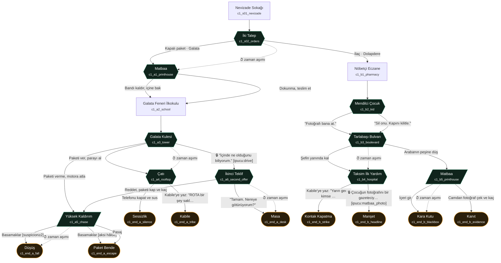

# CİCO — Bölüm 1: "Gece Vardiyası" · Hikâye Akışı

> Bu dosyadaki Mermaid şeması ve sahne tablosu `src/story/chapter1.js`'ten **otomatik üretilir** (`npm run flow`).
> Demo, testler ve bu şema aynı veriyi kullanır; `npm test` şema güncel değilse başarısız olur.

## Öncül

Aslan (Cico), 26 yaşında, Beyoğlu'nda gece kuryeliği yapıyor. Kiraya 1.400 lira eksik.
Nevizade Sokağı'nda meyhaneler dolu; telefonuna iki talep düşer: iyi ödeyen kapalı bir paket ya da bir çocuğun babaannesine ilaç.

**Bu seçimle hikâye iki katmana ayrılır ve bir daha birleşmez.** İki katman da aynı gizeme farklı yerden bakar:
ROTA (Cico'nun çalıştığı kurye uygulaması) kuryeleri gizlice "riskli işi reddetmeyenler" diye sınıflandırıyor ve kazaları örtüyor.

| | Katman A — Paket | Katman B — İlaç |
|---|---|---|
| Bakış | ROTA'yı **içeriden** görür | ROTA'yı **sokaktan** görür |
| Tür | Gerilim: teslim, teklif, kaçış | Dram: dostluk, kaza, dayanışma |
| Kilit karakter | Paltolu adam | mendilci çocuk, Kabile Şefi |
| Ana ikilem | Para ve güvenlik ↔ gerçeği bilmek | Bir dostun yanında kalmak ↔ hesap sormak |
| Sahne / karar / son | 6 / 5 / 5 | 5 / 4 / 4 |

İki katman tek bir mekânda birbirine ayna tutar: **Tarlabaşı'ndaki eski matbaa.** A'da paketin alındığı yer, B'de ROTA'nın gizli merkezi olarak geri döner. Aynı mekân iki katmanda kullanıldığı için üretim maliyeti de düşer.

### Tematik omurga

- **Kuryelerin görünmezliği:** Haberlerde isimsiz bir kurye kazası, ekranda yeşil noktalar. #KuryelerÖlmesin duyarlılığı slogansız, sahnelerle anlatılır.
- **Sistem senin yerine seçer:** Zaman aşımında karar ROTA'ya ya da karşındakine geçer. Kararsızlık da bir karardır.
- **Öğretmenlik yalnızca ayrıntıda:** çocuğun "Hocam" demesi, okulun önünden ağır çekim geçiş. Anma, oyunun en sonunda.

### Karakterler

İsimler kasıtlı olarak az: yalnızca **Cico** ve **Kabile Şefi**. Diğerleri rolleriyle anılır, böylece oyuncu kimin kim olduğunu karıştırmaz.
Her karakter **ilk göründüğü sahnede** tam ekran bir **tanıtım slaytıyla** gelir: büyük adı ve tek sinematik bir cümle. Bir oynanışta her karakter en fazla bir kez tanıtılır (test edilir).

| Karakter | Katman | Tanıtım cümlesi | Nerede tanıtılır |
|---|---|---|---|
| **Cico** | ortak | Aslan. Mahallede herkes Cico der. Yirmi altı yaşında, gece kuryesi. | Nevizade (açılış) |
| **Kabile Şefi** | ortak | Yirmi yıldır bu şehrin her yokuşunu bilir. Kuryeler ona "şef" der. | Nevizade, grup mesajından sonra |
| **ROTA** | ortak | Kuryelerin uygulaması. Her teslimatı, her durağı, her düşüşü kaydeder. | İki Talep |
| **Paltolu adam** | A (B'de son sahne) | Kimse adını bilmiyor. O herkesinkini biliyor. | Galata Kulesi · Kara Kutu |
| **Mendilci çocuk** | B (A'da son mesaj) | İstiklal'de mendil satar. Haritayı Cico'dan öğrendi, şehri herkesten iyi bilir. | Nöbetçi Eczane · A sonları |
| Anne | ortak | (Yalnızca bildirim kartı; slayt yok) | — |

### Mekânlar

Nevizade Sokağı · Tarlabaşı'nda eski matbaa (A ve B) · Galata Feneri İlkokulu (A) · Galata Kulesi (A) · Galata'da bir çatı (A) · Yüksek Kaldırım (A) · Karaköy (A son) · kahvehane (A sonlar) · ofis (A son) · nöbetçi eczane / Dolapdere (B) · Tarlabaşı Bulvarı (B) · Taksim İlk Yardım (B).

Kamondo Merdivenleri çıkarıldı. Hikâyeyle bir bağlantısı yoktu; teslim noktası artık Galata Kulesi'nin dibi.

## Anlatım biçimi (mobil)

- Dikey, tam ekran video; ekranda yazı yok.
- Metin = kısa **vuruşlar** (en fazla 120 karakter, test edilir). Her dokunuşta bir vuruş.
  `line` altyazı gibi altta · `say` konuşmacı adıyla · `msg` üstte telefon bildirimi.
- Seçenekler başparmak bölgesinde, yarı saydam kartlarda.
- Önemli kararlardan sonra kısa bir bildirim: "Kabile Şefi bunu hatırlayacak." İpucu bulunca: "Deftere eklendi."
- Her sahnenin başında mekân etiketi.

## Akış şeması

Şekiller: `[ ]` sinematik · `{{ }}` seçim · `[/ /]` etkileşim (süreli aksiyon) · `([ ])` son.
Kesik ok = zaman aşımı. 🔒 = koşullu seçenek (kilitliyken de görünür).

<!-- FLOW:START (npm run flow ile üretilir, elle düzenlemeyin) -->

| scene_id | tür | başlık | işlev | video_asset |
|---|---|---|---|---|
| `c1_s01_nevizade` | cinematic | Nevizade Sokağı | Soğuk açılış: Nevizade Sokağı. Kira açığı (1.400 ₺) ve Kabile grubu burada ekilir. | — |
| `c1_s02_orders` | choice | İki Talep | İLK KRİTİK SEÇİM — hikâye burada iki katmana ayrılır ve birleşmez. Zaman aşımı → ROTA paketi atar (Katman A). | — |
| `c1_a1_printhouse` | choice | Matbaa | Merak vs. güvenlik. Açmak bilgi verir (teklifte üçüncü seçeneği açar) ama iz bırakır (şüphe +1). | — |
| `c1_a2_school` | cinematic | Galata Feneri İlkokulu | Seçimsiz, nefes alan sahne. Öğretmenliğe tek ince dokunuş. | — |
| `c1_a3_tower` | choice | Galata Kulesi | Ana gizem ve teklif: adam ROTA'nın içinden biri ("Kurye 2608"). Paket açıldıysa üçüncü seçenek açılır, adam bandı fark eder. | — |
| `c1_a4_rooftop` | choice | Çatı | Suç ortaklığından sonra vicdan: Kabile'yi uyarmak mı, susmak mı. | — |
| `c1_a5_chase` | interaction | Yüksek Kaldırım | Basamaklar: şüphe ≥ 2 ise düşer. Pasaj: güvenli ama plaka görülür. Başarısızlık ayrı bir sona (Düşüş) gider. | — |
| `c1_a6_second_offer` | choice | İkinci Teklif | Katman A'nın en ağır ikilemi: sokaktan kurtuluş (maaş, sigorta) karşılığında kayıtları gömmek. | — |
| `c1_b1_pharmacy` | cinematic | Nöbetçi Eczane | Karakter sahnesi. Paket talebi Kabile Şefi'ye düşer; Katman B'nin olayı onun başına gelecek. | — |
| `c1_b2_kid` | choice | Mendilci Çocuk | Kanıt vs. bir çocuğu korumak. Fotoğraf hastanede "gazeteci" seçeneğini açar; ama mendilci çocuk'u riske atar. | — |
| `c1_b3_boulevard` | choice | Tarlabaşı Bulvarı | Katman B'nin kırılma noktası: bir dostu yerde bırakmamak mı, onu yere sereni kovalamak mı. | — |
| `c1_b4_hospital` | choice | Taksim İlk Yardım | Dayanışma mı, kanıt mı. Gazeteci seçeneği yalnızca mendilci çocuk'un fotoğrafı alındıysa açılır. | — |
| `c1_b5_printhouse` | interaction | Matbaa | Katman A'nın başladığı matbaa, burada ROTA'nın gizli merkezi olarak geri döner (mekân tekrar kullanımı + iki katmanın aynası). | — |
| `c1_end_a_silence` | ending | Sessizlik | A son: Sessizlik. | — |
| `c1_end_a_tribe` | ending | Kabile | A son: Kabile. | — |
| `c1_end_a_escape` | ending | Paket Bende | A son: Paket Bende. | — |
| `c1_end_a_fall` | ending | Düşüş | A son: Düşüş. Başarısızlık en büyük ipucunu verir: ROTA'nın risk listesi (ilk seçimde ROTA'nın neden onu seçtiğini açıklar). | — |
| `c1_end_a_desk` | ending | Masa | A son: Masa. Karanlık son; ROTA kancası yok, kanca duran yeşil nokta. | — |
| `c1_end_b_strike` | ending | Kontak Kapatma | B son: Kontak Kapatma. Dayanışma kirayı da çözer. | — |
| `c1_end_b_headline` | ending | Manşet | B son: Manşet. | — |
| `c1_end_b_blackbox` | ending | Kara Kutu | B son: Kara Kutu. ROTA kancası yok; kanca adamın kendisi. | — |
| `c1_end_b_evidence` | ending | Kanıt | B son: Kanıt. | — |

<!-- FLOW:END -->

## Katman A — Paket

1. `c1_a1_printhouse` **Matbaa:** Paketin bandı kalkmış. Açmak mı, dokunmamak mı?
2. `c1_a2_school` **Galata Feneri İlkokulu:** Seçimsiz, ağır çekim. "Fıtı fıtı."
3. `c1_a3_tower` **Galata Kulesi:** "İyi akşamlar, Kurye 2608." Paketi ver / kaç / 🔒 "İçinde ne olduğunu biliyorum."
4. `c1_a4_rooftop` **Çatı:** Kabile'yi uyar ya da sus → *Kabile* / *Sessizlik*
5. `c1_a5_chase` **Yüksek Kaldırım:** Basamaklar (şüphe ≥ 2 ise düşüş) ya da pasaj (plaka görülür) → *Paket Bende* / *Düşüş*
6. `c1_a6_second_offer` **İkinci Teklif:** Maaş, sigorta, sıcak bir masa. Kabul → *Masa*. Reddet → kovalamaca.

## Katman B — İlaç

1. `c1_b1_pharmacy` **Nöbetçi Eczane:** Kapıyı mendilci çocuk açar. "Hocam?"
2. `c1_b2_kid` **mendilci çocuk:** Matbaanın önündeki arabanın fotoğrafı. Al ya da sildir.
3. `c1_b3_boulevard` **Tarlabaşı Bulvarı:** Kabile Şefi yerde. "Kaza değildi babuş." Yanında kal ya da arabanın peşine düş.
4. `c1_b4_hospital` **Taksim İlk Yardım:** ROTA, şefin hesabını kapatır. Kabile'yi topla → *Kontak Kapatma* · 🔒 fotoğrafı gazeteciye gönder → *Manşet*
5. `c1_b5_printhouse` **Matbaa:** Ekranlarda yeşil noktalar; biri kıpırdamıyor: Kabile Şefi. İçeri gir → *Kara Kutu* · fotoğraf çek ve kaç → *Kanıt*

## Zaman aşımı davranışı

| Düğüm | Süre | Zaman aşımında ne olur |
|---|---|---|
| `c1_s02_orders` | 15 sn | ROTA paketi atar → Katman A. Sonda hatırlanır. |
| `c1_a3_tower` | 12 sn | Cico donar; adam paketi alır, yarım ücret (750 ₺). |
| `c1_a5_chase` | 8 sn | Duraksamak = düşüş. |
| `c1_a6_second_offer` | 10 sn | Sessizlik "evet" sayılır → Masa. |
| `c1_b3_boulevard` | 12 sn | Cico donar; ambulans gelir, araba kaybolur → hastane. |
| `c1_b5_printhouse` | 10 sn | Camın önünde donar; kapı arkasından açılır → Kara Kutu. |

Süresiz kararlar (matbaa, mendilci çocuk, çatı, hastane) vicdan kararlarıdır. Süre, duraklat menüsü açıkken durur. Ayarlardan süreler kapatılabilir.

## Sonlar

| Son | Katman | Nasıl | Kanca |
|---|---|---|---|
| Sessizlik | A | Paketi ver → sus | Haberlerde isimsiz bir kurye kazası. |
| Kabile | A | Paketi ver → Kabile'ye yaz | Kuryeler soruyor; şüphe yüksekse plaka tehdidi. |
| Paket Bende | A | Kaç ve kurtul | Kaza Kayıtları elinde. Kime verecek? |
| Düşüş | A | Kaçışta düş | ROTA'nın risk listesinde adı var: ilk seçimde ROTA'nın neden onu seçtiği. |
| Masa | A | İkinci teklifi kabul et | Ekranda duran bir yeşil nokta. |
| Kontak Kapatma | B | şefin yanında kal → Kabile'yi topla | Bir gece boyunca şehirde kurye yok. Kabile kirayı toplar. |
| Manşet | B | şefin yanında kal → fotoğrafı gazeteciye ver | Arabanın sahibi ROTA çıkar. |
| Kara Kutu | B | Arabayı kovala → matbaaya gir | "Hoş geldin, Kurye 2608. Seni bekliyorduk." |
| Kanıt | B | Arabayı kovala → fotoğraf çek ve kaç | Duran noktayı artık herkes görebilir. |

Masa ve Kara Kutu dışındaki sonlar aynı ROTA bildirimiyle biter: "Yarınki rotanız hazır. 08:00 — Galata Feneri İlkokulu." Alıcı adı boş.
Bu, iki katmanı Bölüm 2'de aynı sabahta buluşturmaya hazırlar.

## Bölüm sonu sırası

Son sahne → **Oyun sonu metni** (seçimlerden kurulan, seslendirilecek metin; bkz. `epilogue-voiceover.md`) → **Özet** (kazanç, keşif yüzdesi, kararlar, akış şeması) → **Anma**.

## Neden 22 sahne?

İki katmanın birleşmemesi, sahne sayısını önerilen 10–15'in üstüne çıkarıyor. Ama her oynanış yalnızca **7–9 sahne** görür; bu da tekrar oynamayı değerli kılar.
Üretim yükünü azaltan noktalar: matbaa iki katmanda, kahvehane iki sonda, Nevizade açılışta ve bir sonda ortak; sonlar kısa.
